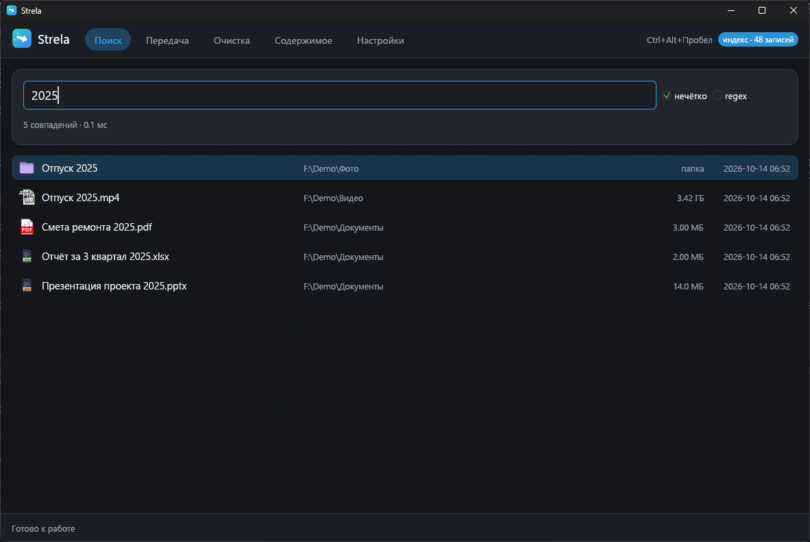
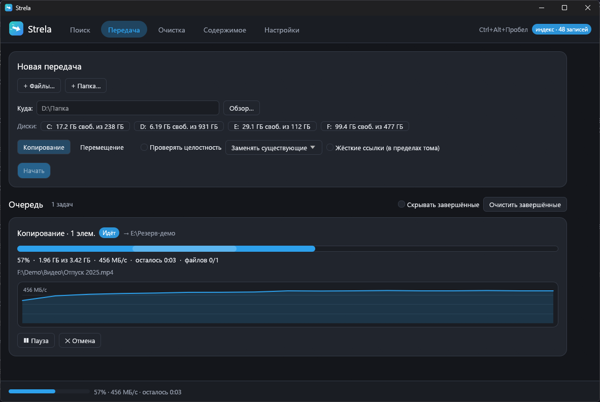
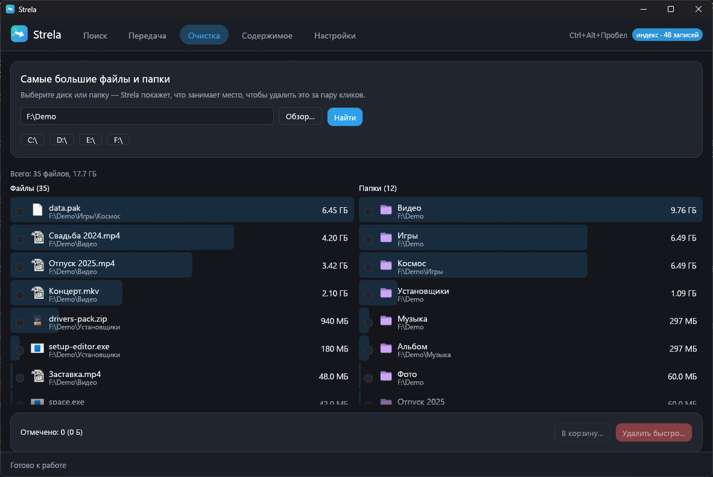
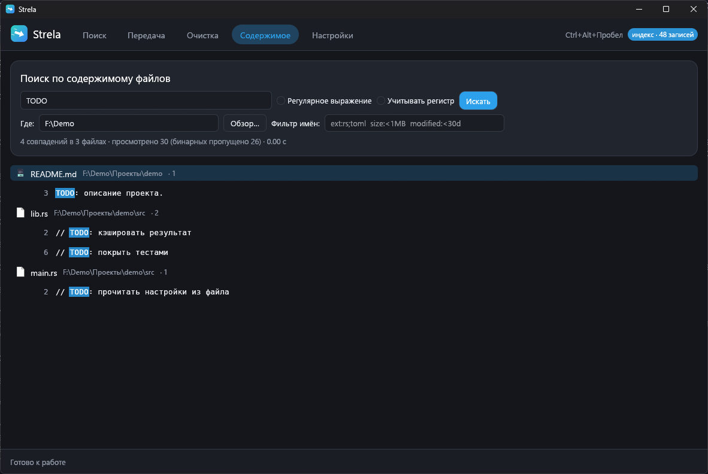
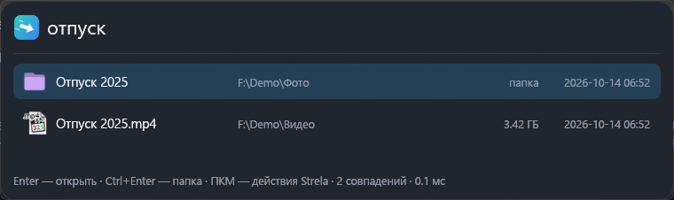
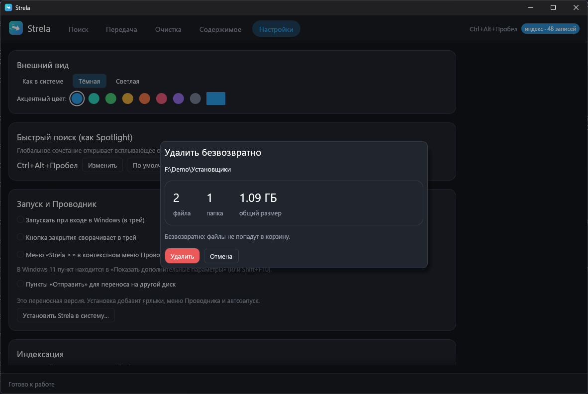
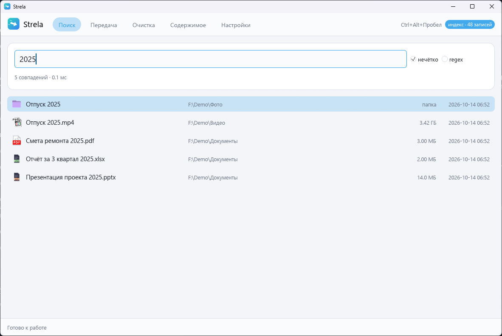
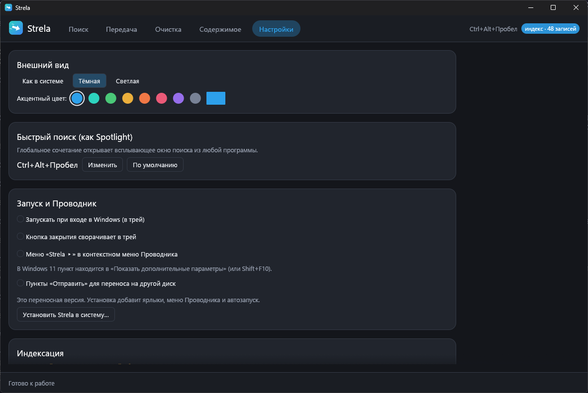

# Strela


**Strela** («стрела») — набор сверхбыстрых файловых операций для Windows 10/11: мгновенный поиск файлов по имени и по содержимому, быстрое копирование и перемещение (между дисками и внутри диска), быстрое удаление и «самые большие файлы». Работает сразу после установки — из контекстного меню Проводника, по глобальной горячей клавише и из собственного окна.



*Все скриншоты сделаны на выдуманных данных (`scripts\screenshots.ps1`): настоящих имён файлов на них нет.*

## Установка

Скачайте `Strela-Setup.exe` со страницы [Releases](https://github.com/ahsoggg-creator/strela/releases/latest) и запустите. Права администратора не нужны — программа ставится в `%LOCALAPPDATA%\Programs\Strela`.

Установщик добавляет:

- ярлык в меню «Пуск» (и на рабочий стол — по желанию);
- подменю **«Strela ▸»** в контекстном меню Проводника — для файлов, папок, фона папки и дисков. В Windows 11 оно находится в классическом меню: **«Показать дополнительные параметры»** или Shift+F10 (пункта в новом коротком меню нет — см. [«Чего нет»](#чего-нет-и-что-сделано-проще));
- пункты **«Отправить»** — «Strela - копировать на диск D», «Strela - переместить на диск D» и так для каждого диска;
- иконку в трее с прогрессом операций и автозапуск при входе в Windows (отключается в «Настройки» или в меню трея);
- глобальную горячую клавишу **Ctrl+Alt+Пробел** (меняется в настройках) — всплывающее окно поиска в стиле Spotlight;
- запись в «Приложения и возможности» для удаления;
- по желанию — службу индексации `StrelaIndexer`: один запрос прав администратора, после этого поиск идёт по MFT и журналу USN, а индекс переживает перезагрузку.

Есть переносная версия — `Strela.exe` из того же релиза; установить её в систему можно позже в «Настройки». Удаление: «Приложения и возможности» или `Strela.exe --uninstall` — убирает программу, ярлыки, меню Проводника, пункты «Отправить», автозапуск, настройки и службу.

Исполняемые файлы **не подписаны**: SmartScreen может написать «неизвестный издатель». Сверьте файл с `SHA256SUMS.txt` из релиза. Никакой телеметрии и сетевых запросов у Strela нет.

## Возможности



**1. Мгновенный поиск по имени, как в Everything.** На NTFS служба читает `$MFT` напрямую (по 8 МБ, разбор записей на всех ядрах) и следит за изменениями через журнал USN; индекс живёт в памяти и сохраняется на диск, поэтому после перезагрузки поиск доступен сразу, а журнал догоняет то, что изменилось. Без службы работает запасной путь: параллельный обход папок (`GetFileInformationByHandleEx` отдаёт сразу 64 КБ записей с размерами и датами) и `ReadDirectoryChangesW`. Имена хранятся в одном буфере вместе с копией в нижнем регистре, поэтому запрос — это один проход по памяти на всех ядрах. Поиск по мере ввода, нечёткое совпадение (`nucleo`), фильтры `ext:mp4;mkv`, `size:>1GB`, `size:1MB..5MB`, `modified:<7d` (за последние 7 дней), `modified:>1y` (старше года), `modified:>2024-01-01`, `path:D:\Games`, регулярные выражения (флаг `regex`).

**2. Быстрая передача между дисками.** Для больших файлов — конвейер «чтение → запись» в разных потоках: большие выровненные буферы (8 МБ), `FILE_FLAG_NO_BUFFERING` с обеих сторон (без двойного копирования через кэш), место под файл резервируется заранее. Мелкие файлы идут параллельно, а способ копирования (собственный или `CopyFile2`) выбирается замером на первых сотнях файлов задачи — на машинах с «тяжёлым» антивирусом выигрывает один, на «лёгких» другой. Сохраняются атрибуты и даты. Опциональная проверка целостности (BLAKE3 или xxh3): источник хешируется на лету, копия перечитывается с диска. **Перемещение между дисками = копирование + проверка + удаление источника** (проверка здесь обязательна). Очередь задач, пауза/продолжить/отмена, скорость, ETA и график; большие файлы пишутся как `имя.strela-part` с отметкой о записанном — прерванную передачу (закрыли программу, выключили питание) можно продолжить.

**3. Быстрое удаление.** Безвозвратное: дерево удаляется параллельно, каждый файл — одним вызовом `FileDispositionInfoEx` с POSIX-семантикой (имя исчезает сразу, даже если файл кем-то открыт; атрибут «только чтение» не мешает). Ссылки и точки соединения удаляются сами, по ним Strela не ходит. В корзину — через `IFileOperation`, как в Проводнике. Перед удалением **всегда** показывается итог: число файлов и папок и общий размер. Корни дисков, `C:\Windows` (вся папка), `Program Files`, `ProgramData`, профиль пользователя и всё, что их содержит, удаляются только после ввода имени папки. Вкладка «Очистка» находит самые большие файлы и папки на диске (из индекса — за миллисекунды).

**4. Быстрый поиск по содержимому, как ripgrep.** Движок `grep-searcher` / `grep-regex` на всех ядрах, бинарные файлы пропускаются, UTF-16 с BOM читается. Кандидаты выбираются теми же фильтрами, что и в поиске по имени (`ext:rs size:<1MB modified:<30d`), из индекса. Результаты подсвечены; Enter открывает файл на нужной строке (VS Code или Notepad++, если установлены; команда настраивается).

**5. Мгновенная передача внутри диска.** Перемещение в пределах тома — переименование записи (`MoveFileExW` без `COPY_ALLOWED`), за O(1) при любом размере: папка в 100 ГБ «переезжает» мгновенно. Копирование в пределах тома на ReFS / Dev Drive — клонирование блоков (`FSCTL_DUPLICATE_EXTENTS_TO_FILE`): данные не копируются, файлы делят кластеры. Опционально — жёсткие ссылки. Один ли это том, Strela определяет сама.

**6. Удаление программ и чистка следов.** Вкладка «Программы» читает список установленных программ из реестра (Program Files, программы пользователя, 32-битные; обновления и системные компоненты не показываются). Три способа удаления: *тихое* (`msiexec /qn` для MSI, `QuietUninstallString` для остальных — без окон), *обычное* (с окнами деинсталлятора) и *принудительное*: Strela сама закрывает процессы и службы программы, мгновенно удаляет её папку быстрым удалителем (параллельно, с POSIX-семантикой, даже если файлы заняты) и убирает запись из списка — без деинсталлятора; для MSI-программ всё равно используется `msiexec`, чтобы в Windows Installer не оставалось «призрака». После этого — **поиск следов**: папки в `Program Files`, `ProgramData`, `AppData` (Roaming, Local, LocalLow, Temp), ярлыки в меню «Пуск» и на рабочем столе, ключи реестра `Software\<Издатель>\<Программа>` (в том числе 32-битное представление), «Uninstall»-записи и `App Paths`, значения автозапуска, службы и задачи планировщика, указывающие в папку программы, кэш установщика MSI. Совпадения делятся на **надёжные** (внутри папки программы, точное название программы или её папки; отмечены сразу) и **вероятные** (совпадает только характерная часть названия; не отмечены, проверьте глазами). Общие названия (`Microsoft`, `Google`, `Windows`…) и папка издателя, в которой есть что-то ещё, не совпадают никогда. Перед удалением показывается список, разделы реестра сохраняются в `.reg`-файлы (`%LOCALAPPDATA%\Strela\backups\…`), защищённые места (`Windows`, `Program Files`, профиль) не трогаются. Для уже удалённой программы можно найти следы по названию.

**7. Менеджер автозагрузки.** Всё, что запускается само, в одном списке: ключи `Run` / `RunOnce` (HKCU, HKLM и 32-битный HKLM), папки «Автозагрузка» (с разбором ярлыков), службы (тип запуска, отложенный запуск, запуск и остановка), задачи планировщика с триггером «при входе» или «при загрузке» (читаются прямо из `System32\Tasks`) и скрытые точки входа только для чтения: `Winlogon\Shell/Userinit`, `AppInit_DLLs`, подмена запуска через `Image File Execution Options`. Переключатель включает и отключает запись **так же, как диспетчер задач** (флаги `StartupApproved`), поэтому два списка всегда совпадают. Для каждой записи — издатель и описание из ресурсов файла, предупреждения («файл не найден», «запускается из временной папки или „Загрузок“»), открытие файла и ключа в regedit, удаление с резервной копией. Системные записи Microsoft и ручные службы скрыты по умолчанию.

**8. Менеджер процессов.** Живая таблица (раз в секунду, только пока вкладка открыта): ЦП, память (рабочий набор и частная), потоки, дескрипторы, ввод-вывод, пользователь, описание из ресурсов файла; сортировка по любому столбцу, фильтр, режим дерева по родителям. Подробности по выбранному процессу: полный путь, командная строка, пик памяти, время запуска и работы, 32/64 бит, список загруженных модулей. Действия: завершить, завершить дерево (дочерние первыми), приостановить и возобновить, приоритет. Критические процессы Windows (`IsProcessCritical`: их завершение даёт синий экран), `System` и сама Strela защищены от завершения. Права администратора нужны только для чужих процессов и служб: кнопка «Открыть от администратора» запускает отдельное окно с этими тремя вкладками (один запрос UAC), основная копия остаётся без повышенных прав.

| Очистка: самые большие файлы и папки | Поиск по содержимому |
| --- | --- |
|  |  |

| Быстрый поиск по горячей клавише | Подтверждение удаления с итогом |
| --- | --- |
|  |  |

| Светлая тема | Настройки |
| --- | --- |
|  |  |

### Горячие клавиши

| Где | Клавиши |
| --- | --- |
| Везде | **Ctrl+Alt+Пробел** — окно быстрого поиска (меняется в настройках) |
| Окно быстрого поиска | ↑↓ PgUp PgDn — выбор · **Enter** — открыть · **Ctrl+Enter** — показать в папке  · **ПКМ** — действия Strela · **Esc** — закрыть |
| Главное окно | Ctrl+1…5 — вкладки · Ctrl+F — к строке поиска · те же клавиши в списке результатов |
| «Содержимое» | Enter в поле — искать · ↑↓ — по совпадениям · Enter — открыть на строке |

### Меню Проводника

«Strela ▸»: **Копировать через Strela** / **Вырезать через Strela** → на фоне папки (или на самой папке, или на диске) **Вставить через Strela**; **Переместить на диск…**; **Быстро удалить**; **Удалить в корзину**; **Найти здесь (по имени)**; **Найти здесь (по содержимому)**; **Самые большие файлы здесь**. Запущена всегда одна копия Strela: команды из меню передаются ей по именованному каналу, а несколько файлов, выбранных сразу (Проводник запускает команду по разу на каждый), собираются в одну задачу.

## Скорость

Поиск по имени, замер на реальной машине (Ryzen 5 7500F, SSD, без прав администратора, индекс обходом папок: 169 666 записей за 0,74 с): запросы `witcher`, `ext:mp4`, `size:>1GB`, `modified:<1d` и `cargo toml` выполняются за 0,3–4,5 мс. Методика, конфигурация машины и оговорки — в [docs/BENCHMARKS.md](docs/BENCHMARKS.md). Скрипт `scripts\bench.ps1` позволяет повторить замеры у себя.

## Сборка

Нужны Rust (stable, edition 2024) и MSVC (Visual Studio Build Tools).

```powershell
cargo build --release                 # target\release\Strela.exe и strela-cli.exe
cargo test --workspace --release
cargo clippy --workspace --all-targets -- -D warnings
powershell -ExecutionPolicy Bypass -File scripts\release.ps1       # тесты, сборка, dist\ и SHA256SUMS.txt
powershell -ExecutionPolicy Bypass -File scripts\bench.ps1         # бенчмарк (docs\BENCHMARKS.md), около часа
```

## Структура

- `crates/core` — движок без интерфейса: `index` (MFT, USN, обход папок, слежение, сохранение), `query` (язык запросов и поиск), `indexer` (оркестратор), `transfer` (конвейер, мелкие файлы, `CopyFile2`, проверка, очередь, докачка), `delete` (удаление, корзина), `guard` (защита системных путей), `largest`, `grep`, `ipc` (именованные каналы), `winapi` (системные вызовы), а также `apps` (установленные программы и их удаление), `leftovers` (поиск и чистка следов), `startup` (автозагрузка), `procs` (процессы), `registry` (тонкая обёртка над реестром);
- `crates/app` — `Strela.exe`: окно на egui/eframe, трей и горячая клавиша (`shell`), команды Проводника (`commands`), установщик и интеграция с Windows (`winint`), служба (`service`), настройки;
- `crates/cli` — `strela-cli.exe`: тот же движок из консоли.

Один и тот же `Strela.exe` — приложение, установщик (если называется `Strela-Setup.exe` или запущен с `--install`), деинсталлятор (`--uninstall`) и служба (`--service`).

| Флаги `Strela.exe` | |
| --- | --- |
| `--install` | установка с окном; `--install --quiet [--no-menu] [--no-sendto] [--no-autostart] [--no-service] [--desktop]` — без окна |
| `--uninstall` | удаление (с `--quiet` — без окна) |
| `--hidden` | запуск в трей (так стартует автозапуск) |
| `--admin [programs\|startup\|processes]` | отдельное окно системных инструментов (его запускает кнопка «Открыть от администратора»; сам по себе флаг права не повышает) |
| `--cmd <команда> -- <пути>` | команда запущенной копии: `copy`, `cut`, `paste`, `move-to`, `fast-delete`, `recycle`, `find-here`, `find-content-here`, `largest-here`, `spotlight`, `open` |
| `--install-service` / `--uninstall-service` | служба (нужны права администратора) |

Примеры `strela-cli`:

```powershell
strela-cli search "отчёт ext:docx modified:<30d"          # мгновенный поиск (индекс обходом, с сохранением)
strela-cli search "^readme\.(md|txt)$" --regex --time
strela-cli search "notepad.exe" --service                  # спросить службу StrelaIndexer
strela-cli copy D:\Photos E:\Backup --verify blake3        # копия с проверкой
strela-cli move D:\Games F:\Games                          # между дисками: копия + проверка + удаление источника
strela-cli move D:\Old D:\Archive                           # в пределах диска: мгновенно
strela-cli delete C:\Temp\big-folder                       # покажет итог и спросит; --recycle — в корзину
strela-cli grep "TODO" -r D:\src -f "ext:rs;toml"           # поиск по содержимому
strela-cli largest D:\ -n 20                               # самые большие файлы и папки
strela-cli apps chrome                                     # установленные программы
strela-cli uninstall "Notepad++" --force --clean -y        # принудительно удалить и сразу убрать надёжные следы
strela-cli traces "Старая программа"                       # следы уже удалённой программы (без --clean — только показать)
strela-cli startup --issues                                # записи автозагрузки с предупреждениями
strela-cli ps -n 15 -c                                     # процессы по нагрузке, с командными строками
strela-cli kill 1234 --tree                                # завершить процесс с дочерними
```

## Чего нет и что сделано проще

- **Пункт в новом (коротком) меню Windows 11 не сделан.** Для него нужен `IExplorerCommand` внутри sparse-пакета, а пакет должен быть подписан сертификатом, которому доверяет компьютер: либо платный сертификат, либо самоподписанный, установленный в «Доверенные лица» (права администратора), либо режим разработчика. Без этого Windows пакет не примет. В Windows 11 «Strela ▸» открывается в классическом меню (Shift+F10 или «Показать дополнительные параметры») — оно полностью работает.
- Чтение MFT и служба проверены не на этой машине, а в CI на настоящем томе NTFS (см. `.github/workflows/ci.yml`), на этой машине без прав администратора индекс строится обходом папок.
- Клонирование блоков ReFS / Dev Drive реализовано, но работает только на ReFS; на NTFS Strela делает обычную копию.
- Собственный конвейер сохраняет данные, атрибуты и даты, но не альтернативные потоки данных и права доступа (ACL). `CopyFile2` их сохраняет — его можно выбрать (`--engine copyfile2`), а для мелких файлов Strela иногда выбирает его сама.
- Символические ссылки и точки соединения при копировании пропускаются (сообщается в отчёте). При индексации у файла с несколькими жёсткими ссылками виден один путь.
- Список программ — это записи «Программ и компонентов» из реестра; приложения из Microsoft Store (UWP/MSIX) в нём не показываются.
- Принудительное удаление обходит деинсталлятор: всё, что он сделал бы кроме удаления файлов (например, отмена привязки лицензии или удаление драйвера через собственный механизм), не выполнится. Для программ Windows Installer это не так: они удаляются через `msiexec`.
- Поиск следов консервативен: он ищет по названию программы, её папки и издателя, а не «по смыслу». Следы, названные иначе, не найдутся; вероятные совпадения нужно просматривать глазами.
- Планировщик задач и часть служб читаются и меняются только с правами администратора; без них Strela пишет об этом, а не молчит.
- Исполняемые файлы не подписаны.
- Служба индексации видит имена файлов на всех дисках и отвечает на запросы любого локального пользователя (как служба Everything); содержимое файлов она не читает. Ставится только по желанию.

## Лицензия

MIT — см. [LICENSE](LICENSE).
